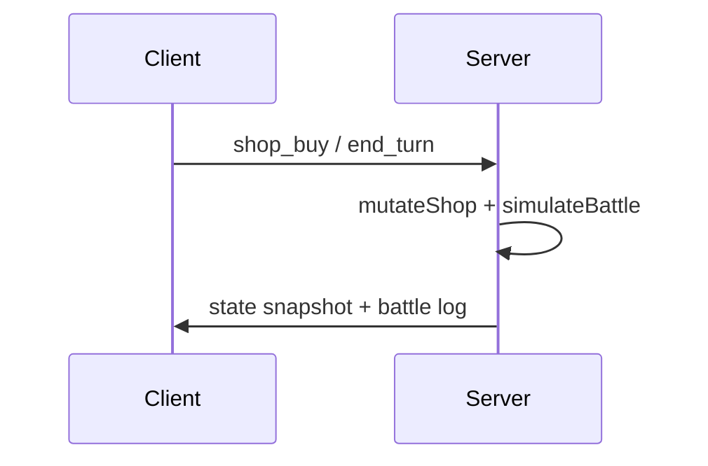

# Game Design Reference

> **For AI agents:** This document describes the active game, design goals, and implementation map. Update this file when gameplay systems change. Do not reference removed tower-defense code — it was deleted as obsolete.

**Last updated:** 2026-11-06

---

## What this game is

**Signal Chain** is a **Super Auto Pets–style auto battler** (cyberpunk theme) with an **authoritative Node WebSocket server** and a thin React client.

- **Shop phase:** spend gold to buy / sell / reroll / freeze units; arrange up to **5** team slots (left = front). Intents are sent to the server; offers/gold/RNG live server-side.
- **Battle phase:** server runs pure `simulateBattle` and returns a log. Clients never decide winners.
- **Run ladder:** 10 lives, 10 wins to clear. Shop tier rises by turn.
- **Modes:** vs AI (server-hosted AI shop) and 1v1 matchmaking queue.
- **Theme:** Signal Chain card identities as **units** with ATK/HP and trigger abilities.

Legacy 5×5 card-chain / run-map code remains under `src/game/cardGame/` and `src/game/run/` but is **not** the active App entry.



## How to run

```bash
npm run server   # ws://127.0.0.1:8787
npm run dev      # Vite client (must reach the server)
```

Optional: `VITE_AB_WS_URL`, `AB_WS_PORT`. See [server/README.md](../server/README.md).

## Active implementation map

| Area | Path |
|------|------|
| Domain (shared) | `src/game/autoBattler/` |
| Net protocol / client view | `src/game/autoBattler/net/` |
| Authoritative WS server | `server/index.ts`, `server/sessionStore.ts` |
| React controller (thin) | `src/autoBattlerController/useAutoBattlerController.ts` |
| UI | `src/ui/autoBattler/` |
| Seeded RNG | `src/game/random/rng.ts` |

### Anti-cheat contract

- Client sends **intents only** (`ClientToServerMessage`).
- Server owns shop state, AI opponent, battle sim, lives/wins.
- Client view strips enemy shop/gold (`toClientRunView` / PvP view builder).
- Same `simulateBattle(seed, teamA, teamB)` on server for vs AI and 1v1.

### Shop rules (v1)

- Gold refill each turn (`goldPerTurn`, default 10).
- Buy 3g, sell 1g, reroll 1g, freeze free.
- Tier from `tierByTurn` table.
- Loss: `livesLostBase + survivingEnemies` (capped).

### Unit roster (v1)

12 units in `units.json` with abilities: none, buff behind, faint summon, splash, snipe, faint AoE, faint hurt, hurt reflect, buff adjacent, KO heal, lonely power, KO push back.

## Roadmap

- [x] Pure seeded battle sim + shop domain
- [x] React shop / battle / end screens
- [x] Authoritative WebSocket server (vs AI + 1v1 queue)
- [x] Client never trusts local battle outcomes
- [ ] More units / packs / merge-upgrade (SAP level-ups)
- [ ] Ranked / Steam auth
- [ ] Spectate / replays from battle logs
- [ ] Retire or archive legacy card-chain entry points

## Changelog

| Date | Change |
|------|--------|
| 2026-11-06 | **Authoritative client/server.** `server/` WebSocket host owns shop RNG, AI, and `simulateBattle`. Client sends intents only; 1v1 matchmaking queue included. |
| 2026-11-06 | **Pivot to Super Auto Pets–style auto battler** on `experimental/auto-battler`. Domain under `src/game/autoBattler/`. |
| 2026-09-21 | Experimental gunpowder-downright card-chain work. See git history on `experimental/gunpowder-downright`. |
| 2026-08–09 | Prior card-chain / run-map feature history. Superseded as active product direction. |
