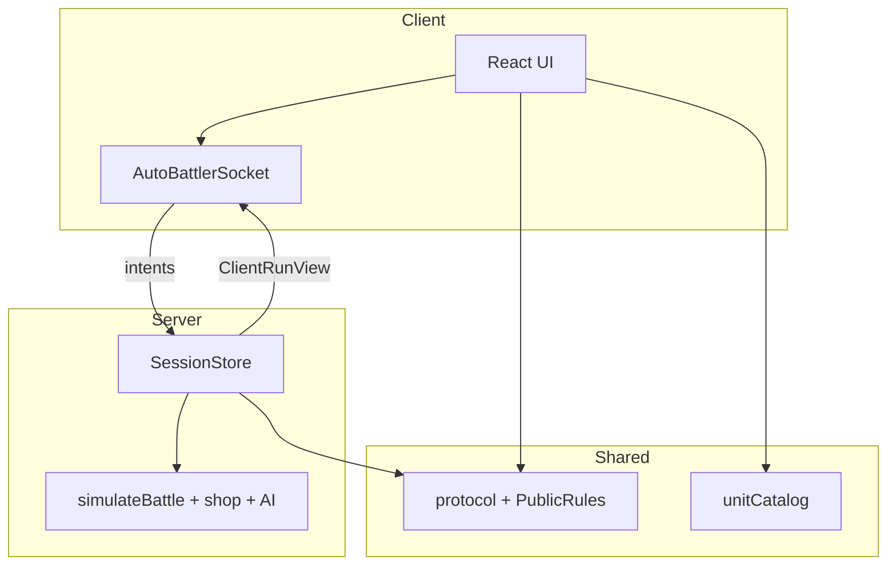

# Game Design Reference

> **For AI agents:** This document describes the active game, design goals, and implementation map. Update this file when gameplay systems change. Do not reference removed tower-defense code — it was deleted as obsolete.

**Last updated:** 2026-11-06

---

## What this game is

**Signal Chain** is a **Super Auto Pets–style auto battler** with a hard **client / server split**:

- **Client** = display + intents (WebSocket). No shop mutations, no battle authority.
- **Server** = gold, offers, AI, `simulateBattle`, lives/wins, matchmaking.
- **Shared** = protocol types, public rule labels, unit catalog (tooltips).



## How to run

```bash
npm run server   # authoritative WS :8787
npm run dev      # Vite client
```

## Implementation map

| Layer | Path |
|-------|------|
| Shared (client-safe) | `src/game/autoBattler/shared/` |
| Client socket | `src/game/autoBattler/client/` |
| Client barrel | `src/game/autoBattler/index.ts` (shared + socket only) |
| Server domain | `src/game/autoBattler/{battle,shop,ai,run,unitRegistry,config}/` |
| Server barrel | `src/game/autoBattler/server.ts` |
| WS host | `server/` |
| Boundary guard | `vite/blockServerAutoBattler.mjs` |

### Anti-cheat rules

1. Client never imports `server.ts`, `battle/`, `shop.ts`, `ai/`, `run/`, or `unitRegistry`.
2. `buildClientRunView` strips enemy shop/gold and run seed; battle log seeds cleared.
3. Welcome pushes `PublicRules` for button labels — server still validates costs.
4. **Online is async:** End turn submits your Turn N lineup. You fight someone else’s Turn N **snapshot** — they are not invited and do not auto-fight you. After a **loss**, **Rematch last lineup** fights a stored ghost of that team (no invite), or **New opponent** re-enters the pool.

## Gameplay (v1)

- Shop: buy/sell/reroll/freeze; 5 slots; front fights first.
- Ladder: 10 lives, 10 wins; tier by turn.
- 12 units in `config/units.json`.
- Modes: vs AI, 1v1 queue.

## Roadmap

- [x] Pure seeded battle sim + shop domain
- [x] Authoritative WS server
- [x] Hard shared/server boundary + Vite import guard
- [x] PvP dual-ack after battle
- [ ] Ranked / Steam auth
- [ ] Spectate / replays
- [ ] More units / merges
- [ ] Archive legacy card-chain entry points

## Changelog

| Date | Change |
|------|--------|
| 2026-11-06 | **Hard client/server boundary.** Shared protocol/catalog only on client; sim/shop/AI server-only; Vite guard; stripped views (no seed/enemy shop); PvP dual battle ack; `PublicRules` on welcome. |
| 2026-11-06 | Auto-battler pivot + first authoritative WS server. |
| 2026-09-21 | Legacy card-chain experimental work — superseded. |
